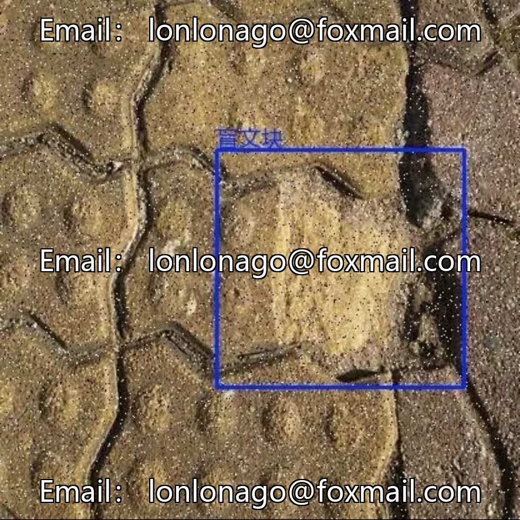
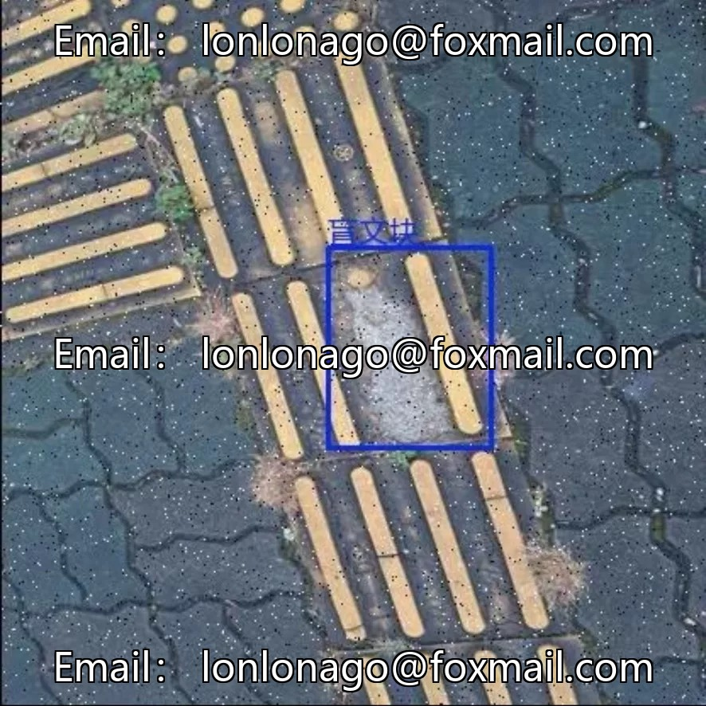
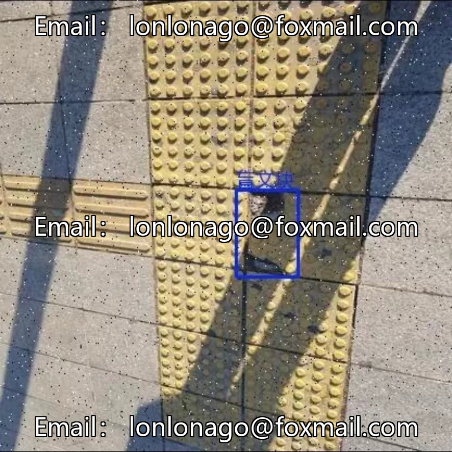
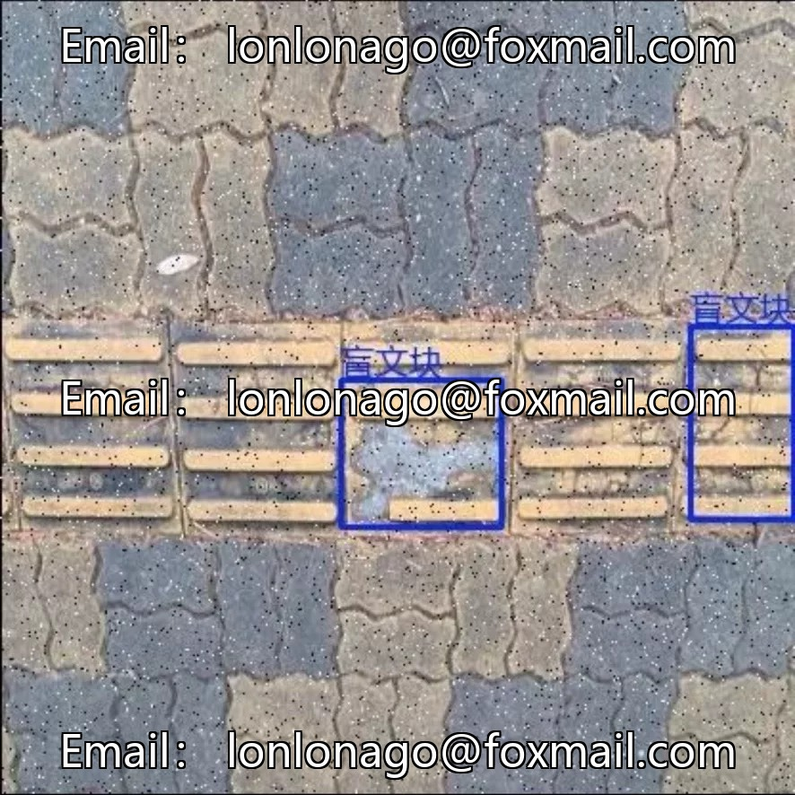
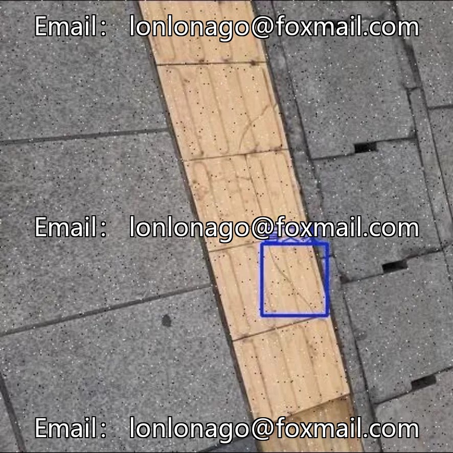

# Urban Tile and Road Defect Detection Dataset

## Body

Urban Tile and Road Defect Detection Dataset

Project number: 10673rd

---

Dataset Overview

Targeting the inspection scenario of smart city infrastructure, this product is dedicated to detecting defects on the surface of urban road bricks and tiles. The dataset consists of 4,100 high-quality annotated images covering 5 common defects, which can be used for applications such as automated inspection, traffic safety warnings, and facility maintenance decision-making.

---

Category system

Cover 5 types of high-frequency ground defects in urban areas (specific category names are subject to the delivery marking documents, examples include).

· Cracked tiles
· Tile damage
· Road cracks
· Road potholes
· Other related surface defects

---

Dataset specifications

Project Specifications
Task Type: Object Detection
Total Images: 4,100
Number of Categories: 5
Annotation Format: Both YOLO format and PASCAL VOC format (XML) are provided.
Scene Characteristics: Real urban scenes with diverse lighting, weather conditions, and shooting angles, natural defects are exhibited.

---

Applicable scenarios

Application direction, specific scenarios
Automated inspection integrated into drone or inspection vehicle systems, real-time identification of road surface brick defects
Traffic Safety Alert: Monitoring road potholes, cracks, and other potential hazards, dispatching maintenance orders in coordination.
Maintenance Decisions: Accumulate defect spatial distribution data to assist in maintenance planning.
Algorithm research for small target detection, fine-grained classification, and lightweight model validation.

---

Usage suggestion

· Dual Format Support: Offers both YOLO and VOC formats, compatible with mainstream detection frameworks (such as the YOLO series, Faster R-CNN), reducing the barrier to entry.
· Scenario Compatibility: The dataset focuses on public urban surfaces like sidewalks, pedestrian paths, squares, etc., aligning with municipal inspection needs.
· Appropriate Scale: 4100 images are suitable for computational resources, suitable for rapid experiments, algorithm validation, and edge deployment prototype development.
· Quality Assurance Recommendation: Before use, it is recommended to conduct a category distribution check and sample quality assurance, and to split training/validation sets by scene (such as different regions, lighting) to enhance generalization.

---

Once shipped

# Blind Path Detection # Road Defects # Ceramic Tiles Damage # Smart City # YOLO Dataset # Issue 10673 # Infrastructure Inspection

## Images

## Payment

Here is a pay link on Stripe ( https://buy.stripe.com/3cs8yP7sY87d0vu9AB ). Please contact me lonlonago@foxmail.com after funding $89, and I will send you a complete data files , thank you!

